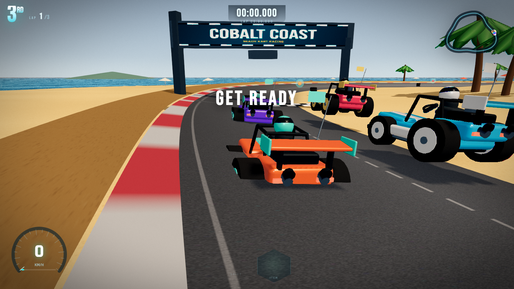
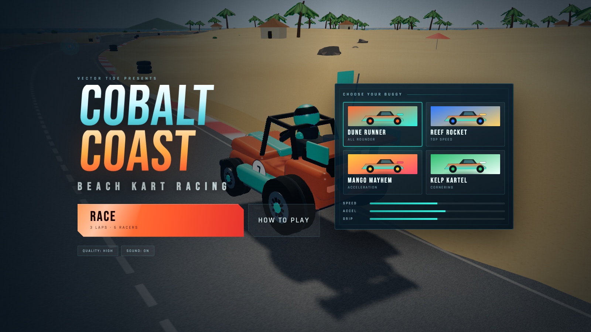
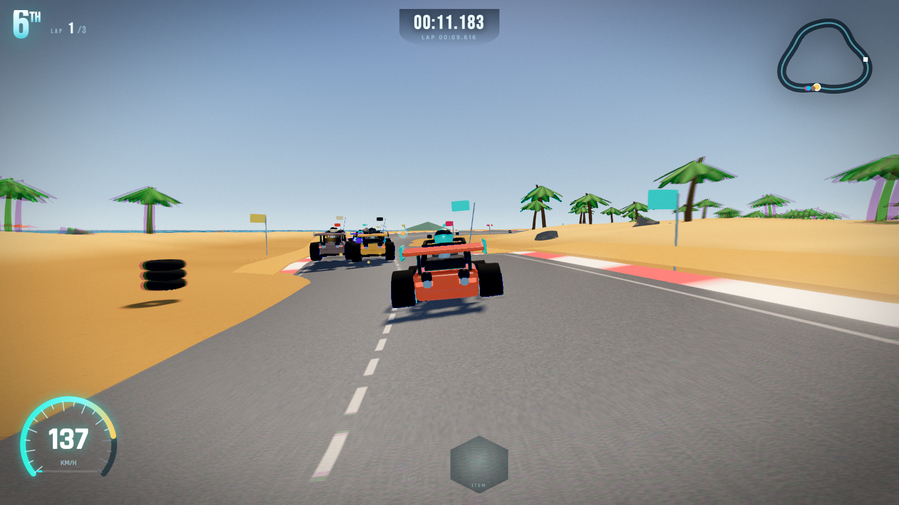
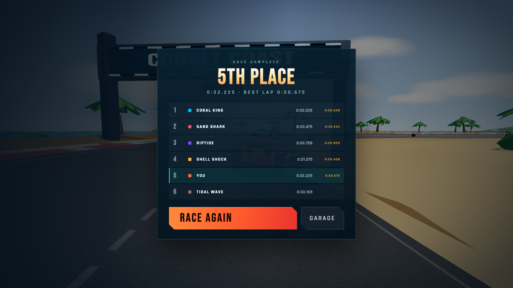

# Cobalt Coast

Un racer arcade de buggies en la playa, jugable en el navegador e instalable como PWA. Inspirado en la fórmula de *Beach Buggy Racing 2*: tres vueltas, seis pilotos, cajas de objetos, derrapes con mini-turbo, tres circuitos y modo copa con puntos.

**Juega online:** https://igutiez.github.io/cobalt-coast/

Todo el arte es procedural (geometría, texturas y audio generados en tiempo de ejecución). No hay assets externos ni conexión a red en partida.



| Garaje | Carrera | Resultados |
| --- | --- | --- |
|  |  |  |

## Jugar

```bash
npm install --workspaces=false   # dentro de este monorepo; fuera de él basta `npm install`
npm run dev                      # http://127.0.0.1:5273
```

Build de producción y vista previa:

```bash
npm run build
npm run preview                  # http://127.0.0.1:5274
```

El build de producción registra el service worker: tras la primera visita la app funciona sin conexión y se puede instalar desde el botón **INSTALL APP** (o el menú del navegador).

## Controles

| Acción | Teclado | Táctil |
| --- | --- | --- |
| Acelerar | automático | automático |
| Girar | `A` / `D` o `←` / `→` | volante abajo a la izquierda (arrastra) |
| Frenar | `S` / `↓` | BRAKE (grande) |
| Derrapar | `SPACE` (o `SHIFT`) | DRIFT |
| Usar objeto | `E` (`Enter` también) | ITEM (grande) |
| Recolocar en pista | `R` | — |
| Pausa | `ESC` / `P` | — |

Derrapa para cargar el mini-turbo: al soltar el derrape recibes un impulso proporcional a la carga. Las cajas dan turbo, misil teledirigido, escudo o mancha de aceite.

## Características

- Tres circuitos con trazados y ambientes propios: **Cobalt Coast** (curvas abiertas, mediodía), **Laguna Twist** (ratonero, atardecer) y **Dune Sprint** (rectas largas, luz dura).
- Copa de 3 carreras con puntos por posición (10-8-6-4-3-2) y campeón final.
- Cuatro buggies con carrocería distinta (buggy, fórmula, muscle y rally), no solo cambio de color.
- Circuito cerrado de ~1,1-1,3 km con peralte, pianos rojo/blanco, arco de salida y línea de meta a cuadros.
- Física arcade propia: velocidad, inercia lateral, derrape con tres niveles de carga, fuera de pista, muros y colisiones entre karts.
- Cinco rivales con IA de trazada, frenada por curvatura, uso de objetos y rubber-banding.
- Objetos: misil con seguimiento, escudo, aceite y turbo, con partículas y sonido.
- Cámara persecución con retardo, FOV dinámico, sacudida y blur radial a alta velocidad.
- Iluminación con sombras dinámicas, environment map procedural, bloom, grading y antialiasing.
- Audio sintetizado: motor, viento, derrape, impactos, avisos y música generativa.
- HUD completo: posición, vuelta, cronómetro, minimapa, velocímetro, objeto y carga de derrape.
- Menú de garaje con cuatro buggies, calidad gráfica conmutable (alta/media/baja) y pantalla de resultados.
- Diseño responsive con controles táctiles y aviso de rotación en vertical.

## Estructura

```
src/
  main.ts            arranque, PWA y pantalla de carga
  game/
    Game.ts          orquestación, estados de carrera, copa, IA, post-proceso
    tracks.ts        definición de los tres circuitos y sus paletas
    Track.ts         spline del circuito, asfalto, pianos, arco de salida
    World.ts         cielo, océano, isla, palmeras, rocas, objetos de pista
    Kart.ts          modelo del buggy y física arcade
    Items.ts         cajas, misiles, aceite y asignación de objetos
    Effects.ts       partículas (polvo, humo, chispas) y marcas de derrape
    CameraRig.ts     cámara persecución y órbita del garaje
    Audio.ts         motor, efectos y música procedural
    Input.ts         teclado y táctil
    textures.ts      texturas de canvas (asfalto, arena, hojas, iconos…)
  ui/
    HUD.ts           velocímetro y minimapa en canvas
    Menu.ts          garaje, resultados, pausa y ayuda
public/
  manifest.webmanifest, sw.js, icons/, fonts/
```

## Rendimiento

El perfil **ALTA** usa pixel ratio hasta 2, sombras de 2048 px y post-proceso completo. En equipos modestos o móviles conviene **MEDIA** o **BAJA** (sin bloom ni SSAO de pantalla). El juego adapta el pixel ratio y la resolución del composer al cambiar de perfil.

## Créditos y alcance

Proyecto original, sin código ni assets de Vector Unit. *Beach Buggy Racing* es una marca de sus respectivos propietarios; este proyecto no está afiliado ni patrocinado. El circuito, los vehículos, los nombres y el audio son originales y generados por código.
